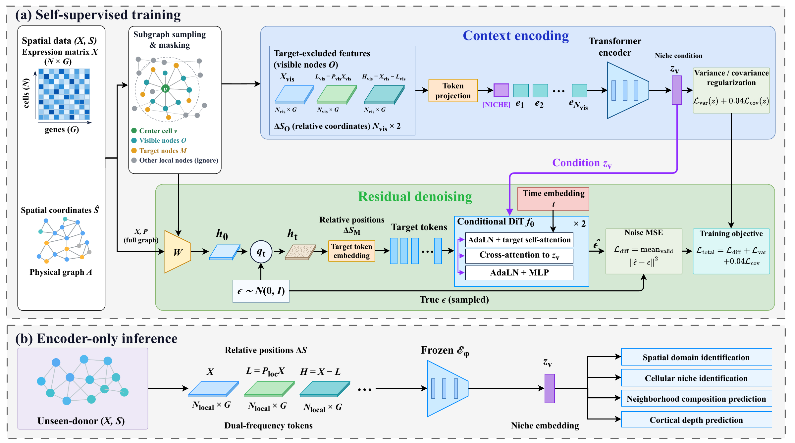

# FreqNiche

### Frequency-aware conditional diffusion learning for cellular niches

FreqNiche learns cellular-niche representations from single-cell spatial
transcriptomics data. It combines local expression, spatial coordinates and
low-/high-frequency expression features in a Transformer encoder. During
self-supervised training, a conditional diffusion model predicts noise in
whitened residual targets, encouraging the encoder to capture informative
neighborhood context. At inference, the frozen encoder produces niche
embeddings for cells from unseen donors without iterative diffusion sampling.

[](data/fig1_freqniche_architecture.pdf)

*Overview of FreqNiche. Click the figure to open the original PDF.*

[Data on Hugging Face](https://huggingface.co/datasets/Honglie/FreqNiche-datasets)
| [Data guide](datasets/README.md)
| [Analysis guide](experiments_analysis/README.md)
| [Baseline guide](baselines/README.md)

## Overview

The framework supports spatial-domain and cellular-niche identification,
neighborhood cell-composition prediction, cortical-depth prediction, and
within-cell-type niche-associated expression analysis. The evaluation workflow
uses donor-separated Train, Validation and Test partitions, with model
selection on Validation and evaluation on held-out Test donors.

The repository provides the model, dataset preparation, training and evaluation
pipelines, downstream analyses, and baseline adapters. Processed data are hosted
separately on Hugging Face. Checkpoints, embeddings, result tables and generated
figures are produced locally when the workflows are run.

## Installation

Use **Linux or WSL2 with Python 3.10**. A CUDA-capable GPU is recommended for
full-scale training; the reproduction launcher defaults to `--device cuda`.
Run all commands below from the repository root.

Create and activate an environment, then install the dependency snapshot:

```bash
conda create -n FreqNiche python=3.10 pip r-base -y
conda activate FreqNiche
python -m pip install -r requirements.txt
```

`requirements.txt` was exported from the main WSL FreqNiche environment
(Python 3.10.20). It includes `rpy2`, which requires R during installation.
GPU drivers must support the installed PyTorch/CUDA runtime. The snapshot
covers Python packages in the main environment; separate baseline environments
and R packages are described in the linked analysis and baseline guides.
R's `mclust` is needed only for the corresponding optional clusterer analysis.

## Data

Download the processed inputs from
[Honglie/FreqNiche-datasets](https://huggingface.co/datasets/Honglie/FreqNiche-datasets).
The release contains **12 H5AD files, approximately 2.79 GB**, plus dataset
manifests and split tables. The following command pins the data revision used
by this code release:

```bash
python -m pip install huggingface_hub
python - <<'PY'
from huggingface_hub import snapshot_download

snapshot_download(
    repo_id="Honglie/FreqNiche-datasets",
    repo_type="dataset",
    revision="98bfe081bfdb6529490bc4f49f69c3360bd516ee",
    local_dir="datasets/h5ad",
    allow_patterns=[
        "human_skin_merfish/*",
        "sea_ad/*",
        "cosmx_human_nsclc/*",
        "xenium_ffpe_lungbreast_gse311609/*",
        "Xenium_Prime5K_Lung/*",
    ],
)
PY
```

| Dataset | Platform | Configuration ID | Evaluation / analysis |
| --- | --- | --- | --- |
| Human Skin | MERFISH | `human_skin` | Cellular-niche identification, neighborhood composition prediction, niche-associated expression |
| SEA-AD MTG | MERFISH | `sea_ad` | Spatial-domain identification and cortical-depth prediction |
| Human NSCLC | CosMx SMI | `cosmx_nsclc` | Cellular-niche identification and design ablations |
| Human NSCLC | Xenium Prime 5K | `xenium_prime5k` | Unlabeled external evaluation and scalability |

Keep directory names and the supplied donor splits unchanged. Xenium uses six
NSCLC sample H5AD files and three additional ROI files for its preparation
audit. See the [data guide](datasets/README.md) for the complete file layout,
AnnData usage, source information and dataset-specific conditions of use.

## Reproduce training and downstream analyses

First inspect the planned commands after installing dependencies and downloading
the data:

```bash
python reproduce.py --dataset human_skin --dry-run
```

Run the default Human Skin workflow:

```bash
python reproduce.py
```

This prepares data and graph caches, trains with seeds **42, 123 and 2024**,
selects each seed's best Validation checkpoint, performs Test inference and
evaluation, and runs neighborhood composition prediction and niche-associated
expression analysis. The expression analysis runs only when its biological
grouping requirements are satisfied, as described below.

Dataset-specific commands are:

```bash
# Human Skin: training, Test evaluation and both downstream analyses
python reproduce.py --dataset human_skin --tasks neighborhood_composition_prediction niche_associated_expression

# SEA-AD: training, Test evaluation and cortical-depth prediction
python reproduce.py --dataset sea_ad --tasks cortical_depth_prediction

# CosMx: training and Test evaluation
python reproduce.py --dataset cosmx_nsclc --stage model

# Xenium: training and unlabeled Test evaluation
python reproduce.py --dataset xenium_prime5k --stage model
```

Spatial-domain and cellular-niche identification are included in model
evaluation. The `--tasks` options select the additional analyses:

| Task option | Dataset | Purpose |
| --- | --- | --- |
| `neighborhood_composition_prediction` | Human Skin | Predict neighborhood cell-type composition from frozen embeddings |
| `cortical_depth_prediction` | SEA-AD | Predict the continuous cortical-depth gradient from frozen embeddings |
| `niche_associated_expression` | Human Skin | Compare Fibro expression between STROMA-enriched and PERIVASC-enriched niches |

To train and evaluate without downstream analysis:

```bash
python reproduce.py --dataset human_skin --stage model
```

To analyze a completed run later, replace `DATE/RUN_ID` with the actual path
printed by the launcher:

```bash
python reproduce.py --stage downstream \
    --run-dir outputs/runs/freqniche/human_skin/DATE/RUN_ID \
    --tasks neighborhood_composition_prediction niche_associated_expression
```

Human Skin and SEA-AD runs export a `downstream_inputs.json` manifest and ordered
Validation/Test center snapshots. Downstream scripts verify data and embedding
hashes, dimensions, barcode order and split separation before computation.

The niche-associated expression analysis uses Seed 42 and requires both niche
groups to meet the specified reference-label enrichment, with at least three
donors contributing at least 20 Fibro cells to each group. Default PERIVASC and
STROMA cluster IDs are `0` and `2`; new training can permute those IDs. If needed,
use `--expression-perivasc-cluster` and `--expression-stroma-cluster` to specify
the corresponding biological groups after inspecting their reported composition.
If the grouping requirements are absent, the analysis stops. See the
[analysis guide](experiments_analysis/README.md) for the full protocol.

## Model configuration

Both entry points use dataset-specific manuscript settings by default:

| Dataset | Embedding dimension | Encoder / DiT layers | Learning rate | Maximum epochs |
| --- | --- | --- | --- | --- |
| Human Skin / CosMx | 128 | 3 / 2 | 1e-3 | 50 |
| SEA-AD / Xenium | 256 | 6 / 4 | 1e-4 | 200 |

Shared settings are 8 attention heads, 50 diffusion steps, a 50-micron spatial
radius, up to 64 local neighbors, up to 32 target nodes, `rho=0.5`,
`p_center_mask=0.3`, weight decay `1e-3`, and covariance weight `0.04`.
Training uses batch size 64, early-stopping patience 7 and `min_delta=1e-4`.
Whitening dimension, MLP ratio and variance weight are 32, 2 and 1.0.
Early stopping can finish training before the maximum epoch count.

`reproduce.py` defaults to `--profile manuscript`. For a custom experiment,
edit `DATASET`, `MODEL` and `TRAINING` in `train.py`. Run `python train.py` for
preparation and Train/Validation, or use `reproduce.py --profile current` with
the desired `--dataset` to include Test and downstream analyses using the edited
parameter dictionaries. `train.py` defaults to `RUN_TEST=False`.

The reproduction launcher also accepts `--device cpu`, `--batch-size` and
`--max-epochs`. Overriding the manuscript settings defines a different experiment.

## Outputs and reproducibility

New model runs are written under:

```text
outputs/runs/freqniche/<dataset>/<date>/<run_id>/
```

Each run records its configuration, manifests, logs, checkpoints and evaluation
assets. Downstream results are saved inside that run's `downstream/` directory,
under the task name. Summary metrics are appended to `outputs/result.csv`.
All generated outputs are excluded from version control.

The main training and downstream entry points rebuild their required caches
from the released data. Supplementary clusterer analyses, ablations and manuscript
plotting scripts can require additional frozen baseline embeddings or other
analysis-specific inputs; consult their guides before running them.

Dry runs validate the command plan and do not train a model or write run assets.
The public workflow has been checked with command plans and synthetic-data
checks; a complete three-seed rerun on the released data has not yet been
performed as part of repository preparation. Numerical results and cluster
assignments can vary across software and hardware environments.

## Baselines and supplementary analyses

- [Baselines](baselines/README.md): method inventory, environment requirements and launch instructions.
- [Downstream analyses](experiments_analysis/README.md): task definitions, independent entry points and statistical protocols.
- [Design ablations](experiments_analysis/ablation/README.md): CosMx component and coordinate ablations, including required frozen inputs.
- [Clusterer sensitivity](experiments_analysis/clusterer_sensitivity/README.md): alternative clustering readouts and input requirements.
- [Figure generation](experiments_analysis/plot_figures/README.md): manuscript plotting scripts and their required assets.
- [Benchmark scripts](scripts/README.md): dataset pipelines, evaluation and recovery utilities.

Third-party baseline implementations retain their upstream licenses and
attribution. Refer to each method's documentation and the data guide when
using or redistributing those materials.

## Repository structure

```text
FreqNiche/
├── reproduce.py             # Training, Test evaluation and downstream analyses
├── train.py                 # Editable Train/Validation configuration
├── requirements.txt         # Main Python environment snapshot
├── pyproject.toml           # Package metadata and dependency ranges
├── configs/                 # Dataset and model configurations
├── src/freqniche_st/         # Data, graph, model and training implementation
├── src/benchmark/            # Benchmark adapters and evaluation utilities
├── scripts/benchmark/       # Preparation, training, evaluation and recovery
├── experiments_analysis/    # Downstream and supplementary analyses
├── baselines/               # Baseline implementations and launchers
├── datasets/README.md       # Download and data usage guide
└── data/                    # Architecture figure and pathway collections
```

## Citation
